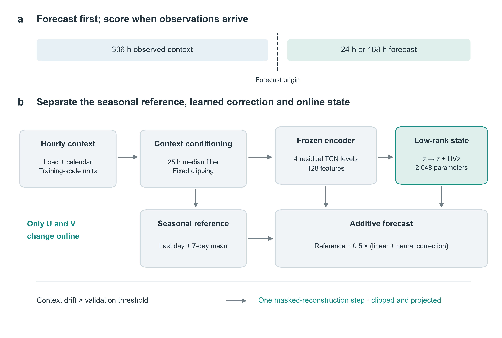

# StableShift

Code, manuscript and reproducibility materials for **Anchored electricity-demand forecasting with bounded label-free adaptation**.

Yanbo Bian · Beijing Jiaotong University · [24722081@bjtu.edu.cn](mailto:24722081@bjtu.edu.cn)

StableShift combines an explicit seasonal reference, learned linear and neural corrections, and a 2,048-parameter online state. The repository includes the five-seed 24 h / 168 h comparison on EIA-930, ECL and Ausgrid, paired component interventions, and a separate regional-transfer analysis.

[Read the manuscript](manuscript_v4/main.pdf) · [Supplementary information](manuscript_v4/supplementary.pdf) · [Source Data](manuscript_v4/source_data) · [Download completed forecasts](https://github.com/bianyanbo44-afk/stable-shift-forecasting/releases/tag/v0.1.0)



## Install

Use Python 3.12 and install the project from the repository root:

```bash
python -m pip install -e ".[analysis]" -r requirements-upstream.txt
```

For GPU training, install the PyTorch build matching your CUDA environment. Recorded environments are retained in `requirements-cuda-lock.txt` and the release's run protocols. `requirements-lock.txt` records the CPU analysis environment; `submission_v4/analysis_environment_lock.txt` captures manuscript post-processing dependencies.

## Reproduce figures and the paper

The committed Source Data and tables are sufficient to redraw the five figures and compile the manuscript:

```bash
python scripts/draw_manuscript_v4.py
python scripts/compile_manuscript_v4.py
```

Compilation requires a LaTeX installation with `pdflatex`, `bibtex`, `elsarticle` and the packages used in the sources. Arial was used for the figures; Matplotlib substitutes an available font when Arial is absent.

To recompute paired statistics and tables, download `Neurocomputing_completed_forecast_evidence_v4.zip` from the [v0.1.0 release](https://github.com/bianyanbo44-afk/stable-shift-forecasting/releases/tag/v0.1.0) and extract it into this repository root, preserving its paths. The archive contains **2,120 completed scenario/variant forecast streams** with predictions, window metrics, model-selection records and source snapshots.

```bash
python scripts/analyze_manuscript_v4.py
python scripts/build_manuscript_assets_v4.py
python scripts/draw_manuscript_v4.py
python scripts/compile_manuscript_v4.py
```

These commands analyze completed experiments; they do not launch training. The release includes a SHA-256 manifest for its archives.

## Data and training

See [reproduction instructions](docs/REPRODUCIBILITY.md) for data preparation, archived run paths and training commands. EIA-930 spans 2023 through June 2026. ECL and Ausgrid provide the historical customer and household benchmarks. Original data remain available from their providers.

The main comparisons use seeds `11, 22, 33, 44, 55`, a 336 h input context, and forecast horizons of 24 h and 168 h. Supplementary experiments report their recorded seed counts. Every quantitative result is linked to saved forecasts through `manuscript_v4/source_data/analysis_manifest.json`.

## Repository layout

| Path | Contents |
| --- | --- |
| `src/stable_shift_forecasting/` | Model, deployment, metrics and paired inference |
| `scripts/` | Data preparation, training, analysis and manuscript generation |
| `configs/` | Main, archival and transfer configurations |
| `manuscript_v4/` | Paper, supplement, bibliography, tables, figures and Source Data |
| `vendor_cache/Time-Series-Library/` | Pinned forecasting baselines and their original license |

## Citation and license

Use [CITATION.cff](CITATION.cff) to cite this software release. The associated manuscript is supplied in this repository.

Original software is available under the [MIT license](LICENSE). Third-party software retains its own license, as listed in [THIRD_PARTY_NOTICES.md](THIRD_PARTY_NOTICES.md). The software license does not relicense third-party datasets or the manuscript text and figures.
