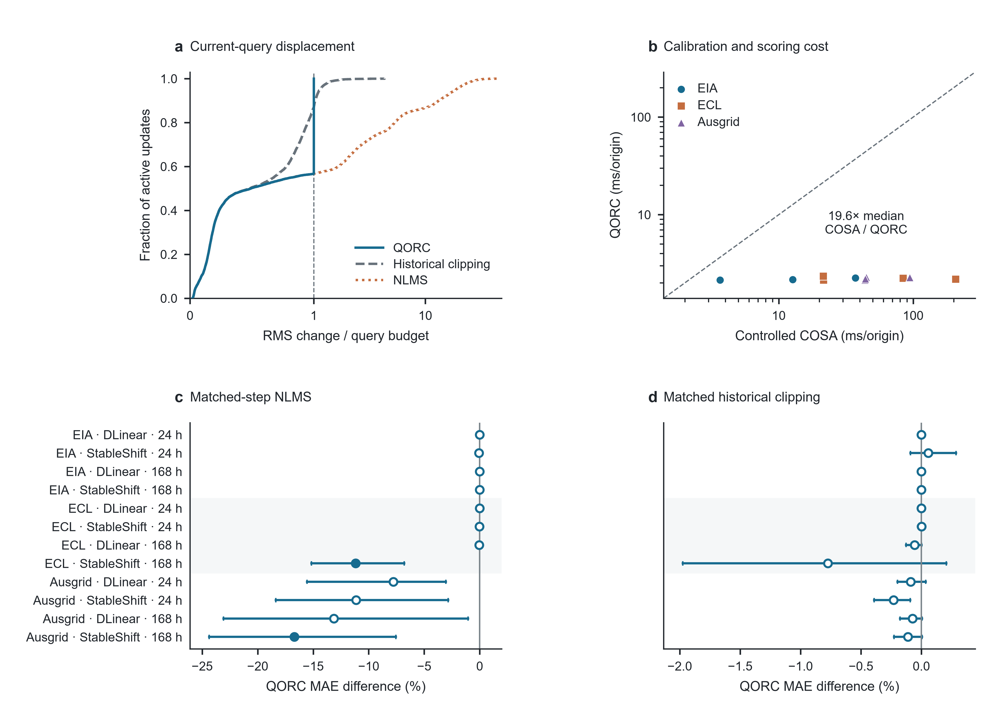
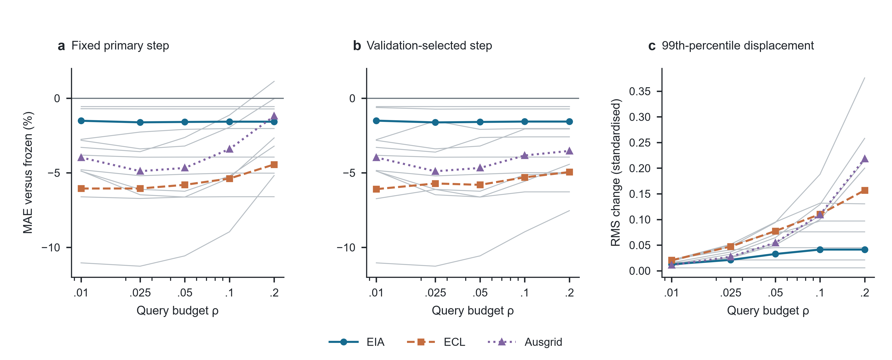

# QORC manuscript artwork

The current figure set uses 183 mm editable vectors, Arial text at 6.5–7 pt, 8 pt panel labels and a common blue/orange/purple dataset palette. Line styles and markers preserve interpretation in grayscale. Forest intervals and all reported settings retain the original scientific evidence.

The numerical data and checkpoint deposit remains QORC v0.3.0. This drawing revision changes typography, layout and visual encodings. The five PDF/SVG figures and PNG previews are in qorc_figures. The Nature research figure guide is the visual benchmark; the manuscript targets Expert Systems with Applications.

To regenerate, install research_strengthening_20261009/requirements-artwork.txt and extract QORC_Source_Data_v0.3.0.zip from the versioned release into research_strengthening_20261009/analysis. Run:

```bash
python research_strengthening_20261009/draw_publication_artwork.py
```

The script produces PDF, SVG, 600 dpi PNG and TIFF plus fresh alignment, font-size and collision reports. It retains every reported comparison, displacement tail and budget setting. Statistical families and pointwise 95% intervals are unchanged.

## Preview




